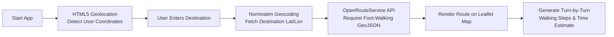

# Byte-Beginners — AI Smart Walking Navigation (M4)

An accessibility-focused walking navigation system designed for visually impaired people and pedestrians. This module provides real-time GPS tracking, destination geocoding via OpenStreetMap Nominatim, and accessible turn-by-turn walking directions using the OpenRouteService (ORS) API.

---

## Features

- **Real-Time GPS Tracking**: Automatically acquires and updates current device coordinates (latitude, longitude, accuracy) using the high-accuracy HTML5 Geolocation API.
- **Interactive OpenStreetMap Display**: Renders smooth maps, custom user position markers, and destination markers using Leaflet.js.
- **Destination Search**: Locates addresses and landmarks worldwide using the OpenStreetMap Nominatim geocoding engine.
- **Foot-Walking Route Engine**: Calculates optimal pedestrian routes via OpenRouteService's `foot-walking` API.
- **Turn-by-Turn Guidance**: Displays clean, numbered walking directions with distance per segment (e.g., *"Turn left onto Main St — 85 metres"*).
- **Route Summary**: Displays total walking distance in kilometres and estimated transit time in minutes.
- **Accessibility First**: Clean visual contrast and semantic elements suitable for screen readers and assistive tech.

---

## Tech Stack

- **Frontend**: HTML5, Vanilla CSS3, JavaScript (ES6+)
- **Mapping & Geocoding**: [Leaflet.js](https://leafletjs.com/), [OpenStreetMap](https://www.openstreetmap.org/), Nominatim API
- **Routing Engine**: [OpenRouteService API](https://openrouteservice.org/) (`foot-walking`)
- **Backend / Python Core**: Python 3.9+ (`ai_smart_navigation.py`, `backend/navigation.py`)

---

## Project Structure

```text
AI_NAVIGATION_FOLDER/
├── backend/
│   └── navigation.py          # Backend navigation logic & utilities
├── fronted/
│   ├── index.html             # Navigation interface & accessible markup
│   ├── map.js                 # GPS tracking, Nominatim search, & ORS routing logic
│   └── style.css              # Responsive, accessible stylesheet
├── ai_smart_navigation.py     # Main Python AI navigation entrypoint
├── .gitignore                 # Standard Python & OS ignore rules
├── push_to_m4.bat             # Convenience Git push helper script
└── README.md                  # Milestone documentation
```

---

## Prerequisites

- A modern web browser (Google Chrome, Microsoft Edge, Firefox, or Safari) with location services enabled.
- Python 3.9+ (optional, for running local static servers or backend scripts).
- An [OpenRouteService](https://openrouteservice.org/dev/#/signup) API token.

---

## Getting Started

### 1. Clone the Branch
```bash
git clone -b M4 https://github.com/harshith-rg/Byte-Beginners.git
cd Byte-Beginners
```

### 2. Configure Your API Key
Open `fronted/map.js` and ensure your OpenRouteService API key is set at line 8:
```javascript
const ORS_API_KEY = "YOUR_OPENROUTESERVICE_API_KEY";
```

### 3. Run the Application

You can launch the frontend using any local web server:

**Using Python:**
```bash
# Navigate to the frontend directory
cd fronted

# Start a local HTTP server
python -m http.server 8000
```
Open your browser and navigate to:
```text
http://localhost:8000
```

**Using VS Code / Antigravity IDE:**
- Right-click `fronted/index.html` and select **"Open with Live Server"**.

---

## How It Works



1. **Location Detection**: When the page loads, `startGPS()` activates `navigator.geolocation.watchPosition()`, plotting the user's location with a marker on the map.
2. **Geocoding**: Entering a destination and clicking **Search Destination** queries the OpenStreetMap Nominatim service to resolve coordinates.
3. **Route Calculation**: Clicking **Get Walking Route** sends a request to OpenRouteService with origin and destination coordinates.
4. **Directions & Rendering**: The returned GeoJSON path is plotted on the Leaflet map in blue, and turn-by-turn pedestrian steps with distances are generated.

---

## Milestone Status

| Component | Status | Description |
| :--- | :---: | :--- |
| **GPS Geolocation** | Completed | High-accuracy continuous location tracking |
| **Map Rendering** | Completed | Leaflet + OpenStreetMap integration |
| **Destination Search** | Completed | Geocoding with Nominatim API |
| **Walking Directions** | Completed | Pedestrian routing via OpenRouteService |
| **UI Accessibility** | Completed | High-contrast, clean layout for assistive reading |

---

## Team

**Byte-Beginners**  
*Accessible AI Navigation Assistant*